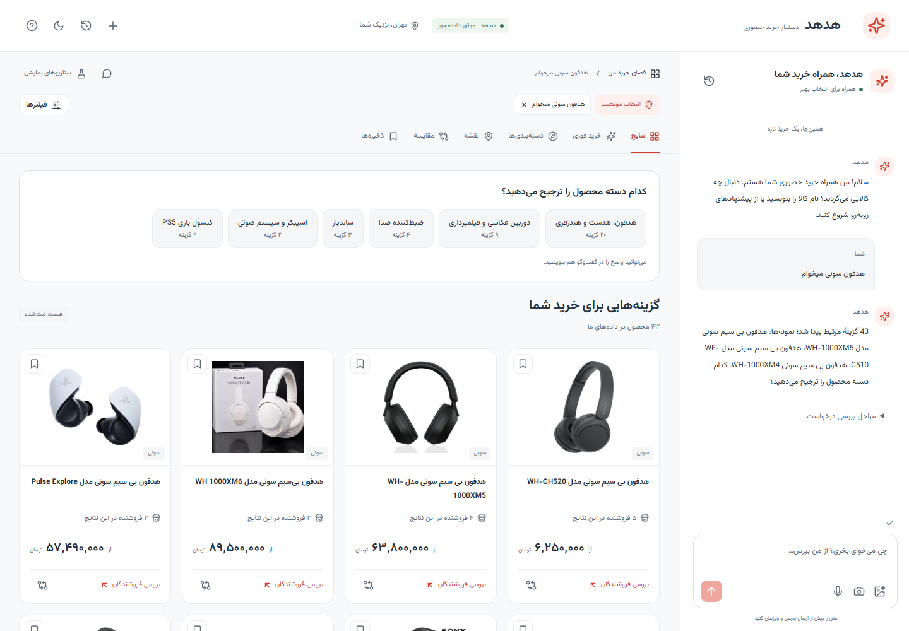
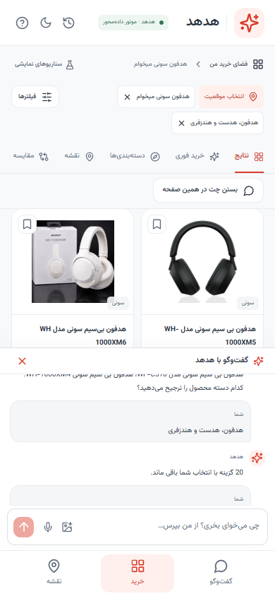
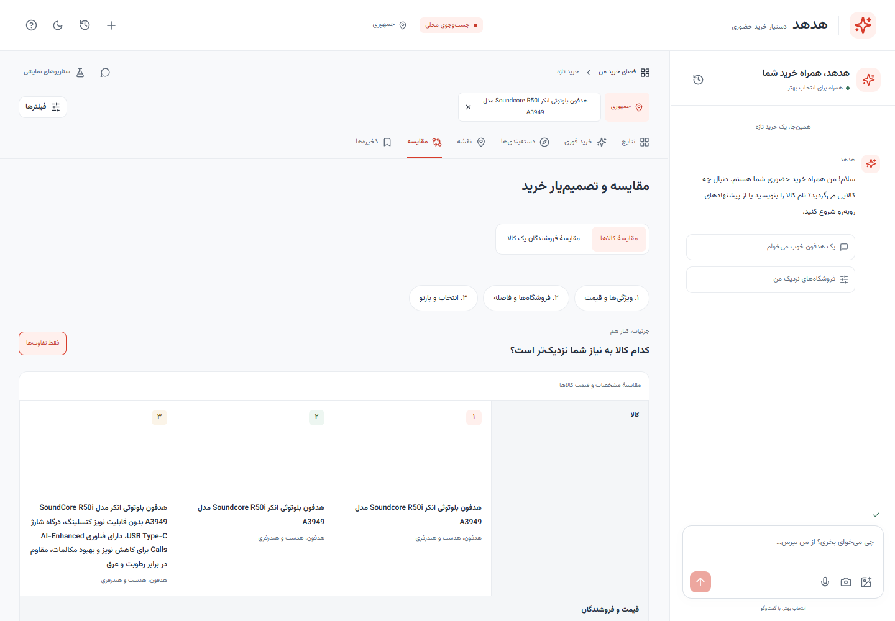
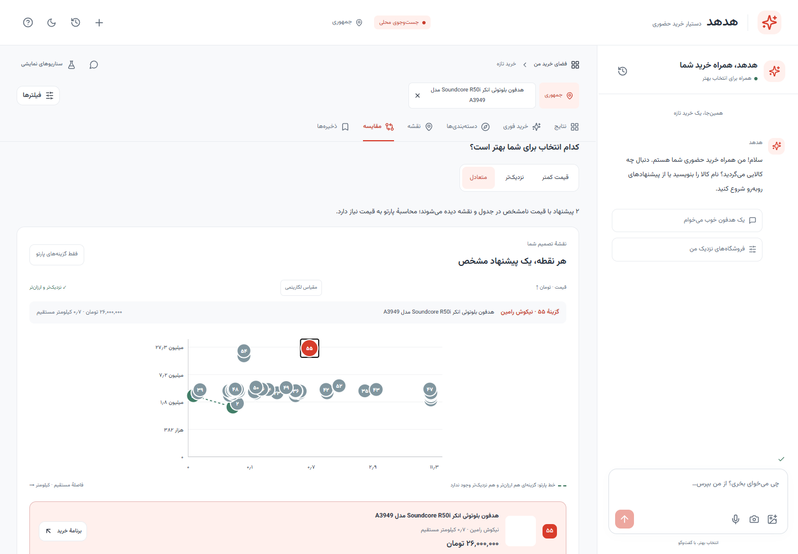
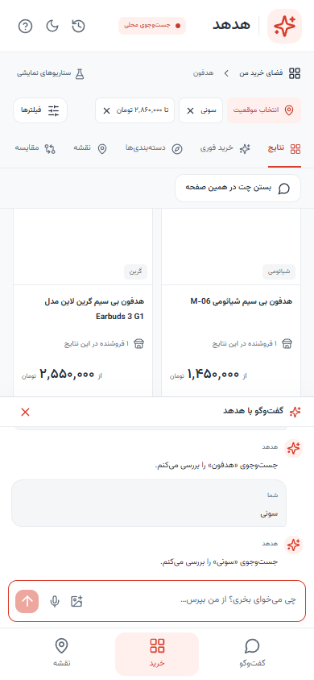
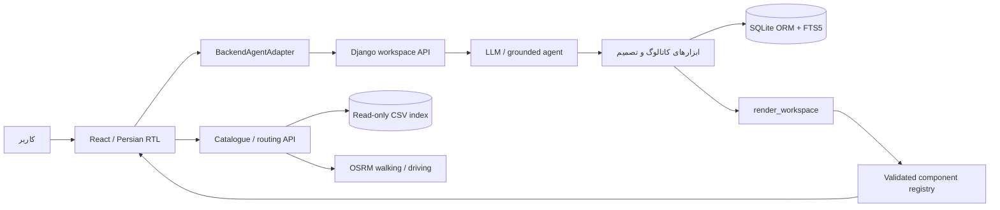

<div dir="rtl">

# هدهد | HodHod

### از گفت‌وگو تا رسیدن به فروشگاه

دستیار خرید حضوری با رابط تعاملی فارسی؛ برای انتخاب کالا، مقایسهٔ فروشنده‌ها و برنامه‌ریزی مراجعه به فروشگاه. هدهد پاسخ را به کارت کالا، نقشه، مقایسه و برنامهٔ خرید تبدیل می‌کند تا تصمیم و اقدام در همان صفحه انجام شوند.



**React · TypeScript · Django · OpenAI-compatible tools · MapLibre · RTL**

## قابلیت‌ها

«ساعت ۱۱:۳۰ شب است و شارژر می‌خواهم» فقط یک جست‌وجوی قیمت نیست. کاربر باید بداند کدام فروشگاه کالای مناسب دارد، آیا تا زمان رسیدن باز می‌ماند و اگر انتخاب اول جواب نداد چه گزینه‌ای دارد.

- **گفتگوی متصل به ابزارها:** جستجو در دیتاست، سؤال تکمیلی با گزینه‌های واقعی، فیلتر و رتبه‌بندی؛ مدل نمای مناسب را انتخاب می‌کند.
- **نقشهٔ تعاملی:** موقعیت انتخاب‌شدهٔ کاربر، فروشگاه‌های مرتبط، دایرهٔ شعاع جستجو و هماهنگی نقشه با انتخاب‌ها.
- **مقایسه و تصمیم‌یار:** مقایسهٔ کالاهای متفاوت بر اساس مشخصات و قیمت؛ مقایسهٔ فروشنده‌های یک کالا بر اساس قیمت و فاصله؛ نمودار پارتو برای بررسی مصالحه‌ها.
- **برنامهٔ مراجعه:** اطلاعات کالا و فروشگاه، ساعت کاری، مبلغ ثبت‌شده و تعداد، مسیر پیاده و خودرو و زمان رسیدن.
- **خرید فوری:** بررسی زمان رسیدن و ساعت کاری، پیشنهاد جایگزین و برنامه‌ریزی دوباره پس از گزارش «بسته بود» یا «موجود نبود».
- **ورودی و تاریخچه:** عکس و شناسایی کالا با مدل، تایپ صوتی در مرورگرهای پشتیبان، ذخیرهٔ گفتگوها و انتخاب‌ها در IndexedDB.
- **طراحی واکنش‌گرا:** دسکتاپ، تبلت و موبایل، تم روشن و تیره و چت داخل صفحهٔ خرید در موبایل.

## تصاویر برنامه

تصاویر از اجرای خود برنامه گرفته شده‌اند. تصاویر گفتگوی متصل با موتور داده‌محور و کاتالوگ واقعی ثبت شده‌اند؛ نمونه‌های مقایسه و موبایل از سناریوهای قابل تکرار برنامه هستند. تصویر تولیدشده با AI به جای دادهٔ منبع استفاده نشده است.

| گفتگوی تعاملی در موبایل | مقایسهٔ کالاها و فروشندگان |
| --- | --- |
|  |  |

| تصمیم با نمودار پارتو | چت در کنار خرید روی موبایل |
| --- | --- |
|  |  |

[تصاویر بیشتر و شرایط ثبت آن‌ها](docs/screenshots/README.md)

## راه‌اندازی سریع

### پیش‌نیازها

- Node.js 22 یا جدیدتر و pnpm با پشتیبانی از lockfile نسخهٔ ۹.
- Python 3.11 یا جدیدتر، دارای SQLite و FTS5.
- سه فایل اصلی `shops.csv`، `products.csv` و `offers.csv` در پوشهٔ `data/`.
- اینترنت برای نصب وابستگی‌ها و استفاده از مدل، نقشه، تصاویر خارجی و مسیریابی.

### ۱. دریافت پروژه و داده‌ها

```bash
git clone https://github.com/Agentic-Hackathon/HodHod.git
cd HodHod
```

دیتاست مسابقه در Git نگهداری نمی‌شود. [آرشیو دیتاست چالش](https://startech.s3.ir-central1.arvanstorage.ir/starcoach-dataset-v16-cap300-csv.zip?versionId=) را دریافت و سه CSV را طبق [راهنمای داده‌ها](data/README.md) در `data/` قرار دهید. برنامه داده یا موجودی ساختگی جایگزین نمی‌کند.

### ۲. تنظیم مدل

مدل پیش‌فرض `gpt-5-mini` است. کلید و **Base URL باید متعلق به همان ارائه‌دهنده باشند**. برای ارائه‌دهندهٔ سازگار با OpenAI، آدرس خودش را بدهید؛ پیش‌فرض زیر برای OpenAI مستقیم است.

Windows PowerShell:

```powershell
powershell.exe -NoProfile -ExecutionPolicy Bypass -File .\configure-model.ps1 -BaseUrl "https://api.openai.com/v1"
```

کلید در ورودی مخفی گرفته و در `.env` ریشه ذخیره می‌شود. برای سرویس دیگر، مقدار `-BaseUrl` را با آدرس اعلام‌شدهٔ ارائه‌دهنده عوض کنید. این فرمان سیاست اجرای دائمی ویندوز را تغییر نمی‌دهد.

Linux/macOS: فایل `.env.example` را به `.env` کپی و این مقادیر را ویرایش کنید:

```dotenv
LLM_PROVIDER=openai
LLM_MODEL=gpt-5-mini
LLM_BASE_URL=https://api.openai.com/v1
LLM_API_KEY=YOUR_SERVER_SIDE_KEY
```

کلید را در `VITE_*` قرار ندهید. بدون کلید، موتور داده‌محور بک‌اند قابل استفاده است؛ این حالت پاسخ زندهٔ مدل نیست. پس از تغییر `.env` سرورها را دوباره اجرا کنید.

### ۳. اجرای کامل

Windows PowerShell یا Git Bash روی ویندوز:

```powershell
powershell.exe -NoProfile -ExecutionPolicy Bypass -File .\start.ps1 -Production
```

Linux/macOS:

```bash
bash start.sh --production
```

راه‌انداز وابستگی‌ها را نصب، دیتاست را ایندکس و وارد ORM می‌کند، migrationها را اجرا می‌کند و هر سه سرویس را بالا می‌آورد. اجرای اول به زمان و فضای دیسک برای ساخت دو ایندکس نیاز دارد. واردسازی بعدی، دادهٔ بدون تغییر را دوباره نمی‌سازد.

| سرویس | آدرس پیش‌فرض |
| --- | --- |
| رابط هدهد | http://127.0.0.1:5173 |
| API کاتالوگ و مسیریابی | http://127.0.0.1:8787 |
| موتور Django / Waitress | http://127.0.0.1:8790 |

با `Ctrl+C` سرویس‌های همان اجرا متوقف می‌شوند. برای توسعه، `-Production` یا `--production` را حذف کنید. راه‌انداز برای اجرای محلی است؛ استقرار عمومی به تنظیم دامنه، HTTPS، سرویس‌ها و دیتابیس نیاز دارد.

## معماری



مدل نام کامپوننت و شناسهٔ موجودیت را انتخاب می‌کند. قیمت، تصویر و مختصات کارت‌ها از رکورد واقعی منبع خوانده می‌شوند؛ HTML یا JavaScript تولیدشدهٔ مدل اجرا نمی‌شود. قرارداد خروجی با Zod بررسی می‌شود. نشست Django، CSRF و شناسهٔ هر درخواست به جداسازی گفتگوها و رد پاسخ قدیمی کمک می‌کنند.

```text
HodHod/
├── src/                    # رابط React، state، چت، نقشه و رجیستری کامپوننت‌ها
├── backend/                # موتور اصلی Django، ابزارها و bridge رابط
├── scripts/                # واردسازی، API داده، راه‌اندازی و آزمون اتصال
├── tests/                  # Vitest و Playwright
├── data/                   # راهنمای دیتاست؛ CSVها محلی و gitignored
├── docs/                   # معماری، قراردادها، گزارش‌ها و screenshots
├── .github/workflows/      # بررسی فرانت و بک‌اند در GitHub Actions
├── .env.example            # تنظیمات نمونه، بدون کلید
├── configure-model.ps1     # تنظیم امن مدل در ویندوز
├── start.ps1               # اجرای یکپارچه در ویندوز
└── start.sh                # اجرای یکپارچه در Linux/macOS
```

بک‌اند موجود و migrationهای آن حفظ شده‌اند. اجرای مستقل محلی از SQLite استفاده می‌کند؛ پیکربندی PostgreSQL و `docker-compose.yml` نیز باقی است. Docker برای مسیر پیش‌فرض لازم نیست. بازیابی معنایی اختیاری است و در مسیر پیش‌فرض مدلی دانلود نمی‌شود.

## داده‌ها و حدود نتیجه

نسخهٔ بررسی‌شده شامل **۲۲۵٬۹۰۳ کالا، ۳۳۱٬۵۰۶ آفر و ۶٬۴۷۶ فروشگاه** است. CSVها تغییر نمی‌کنند و شناسه‌های اصلی بین بک‌اند و رابط حفظ می‌شوند. دو ایندکس در `.local/torob.sqlite` و `.local/brain.sqlite3` ساخته می‌شوند.

- عکس‌ها و مشخصات از دیتاست‌اند؛ قیمت آفر ثبت‌شده است و تضمین موجودی زنده نیست.
- همهٔ شماره‌ها و بسیاری از نام‌های فروشگاه‌ها در دیتاست مسابقه مصنوعی‌اند؛ برنامه از شماره‌ها برای تماس استفاده نمی‌کند.
- موقعیت کاربر از اجازهٔ مرورگر یا انتخاب خودش گرفته می‌شود. فاصلهٔ مستقیم با زمان سفر اشتباه گرفته نمی‌شود.
- مسیر و زمان پیاده/خودرو از مسیریاب دریافت می‌شود؛ در قطعی ETA ساخته نمی‌شود و ترافیک زنده محاسبه نمی‌شود.
- تایپ صوتی به پشتیبانی و مجوز مرورگر وابسته است؛ تبدیل فایل صوتی آپلودشده هنوز ارائه‌دهنده ندارد.
- شناسایی عکس به مدل متصل است؛ عبارت تشخیص‌داده‌شده پیش از جستجو قابل ویرایش است.
- جستجوی اکتشافی بیرون ترب، با موجودی نامعلوم و جدا از آفر فروشندگان نمایش داده می‌شود.

نقشهٔ پیش‌فرض از OpenStreetMap و مسیریابی از سرویس‌های عمومی FOSSGIS/OSRM استفاده می‌کند. برای انتشار عمومی از سرویس مناسب یا نمونهٔ میزبانی‌شدهٔ خودتان استفاده کنید. تنظیمات در `.env.example` آمده‌اند.

## آزمون‌ها

با فعال‌بودن محیط Python پروژه:

```bash
pnpm lint
pnpm test
pnpm build
python backend/manage.py test shopping --settings=config.test_settings --noinput
python scripts/test_routing.py
```

با وجود دیتاست و ایندکس‌ها و اجرای سرورها:

```bash
python scripts/test_data.py
python scripts/test_mission.py
python scripts/test_brain_integration.py
pnpm test:e2e
```

برای Playwright، مسیر مرورگر را با `PLAYWRIGHT_BROWSER_PATH` مشخص کنید؛ روی ویندوز Edge نصب‌شده پیش‌فرض است. در Linux/macOS می‌توانید `pnpm exec playwright install chromium` را اجرا کنید. برای تست کامل آفلاین، برنامه را در حالت production اجرا و `TOROB_PRODUCTION_URL=http://127.0.0.1:5173` را تنظیم کنید. آزمون‌های قطعی گفتگو را با `AGENT_MODE=grounded` اجرا کنید تا به اعتبار API وابسته نباشند.

بررسی محلی شامل **۵۴ آزمون فرانت، ۱۸ آزمون Django، ۱۱ آزمون دیتاست، ۴ آزمون مسیریابی، ۵ آزمون خرید فوری و ۲۳ آزمون مرورگر** بوده است. آزمون مستقل اتصال، برابری کارت‌ها با منبع و مسیرهای نقشه/مقایسه/مراجعه را بررسی می‌کند. بعضی پاسخ‌های مسیریابی در آزمون مرورگر کنترل می‌شوند؛ پاس‌شدن آن‌ها ادعای دسترس‌پذیری دائمی سرویس خارجی نیست.

تست محدود مدل واقعی پس از تنظیم کلید:

```bash
python scripts/verify_model.py
```

این فرمان به ارائه‌دهنده درخواست واقعی می‌فرستد. تست حلقهٔ ابزار با ارائه‌دهندهٔ شبیه‌سازی‌شده، جای تست زندهٔ مدل نیست.

## سناریوها و مستندات

- `/` — فضای اصلی خرید، پیش‌فرض متصل به موتور هدهد.
- `/?mode=demo` — سناریوهای قابل تکرار روی دیتاست واقعی.
- `/showcase` — انتخاب سناریوهای نمایشی.
- `/gallery` — رجیستری کامپوننت‌ها و حالت‌های خالی، خطا و مجوز.

| سند | موضوع |
| --- | --- |
| [معماری](docs/ARCHITECTURE.md) | رابط و state |
| [اتصال بک‌اند](docs/BACKEND_CONNECTION.md) | API، مدل، نشست و ابزارها |
| [قرارداد Generative UI](docs/AGENT_INTEGRATION.md) | envelope، رویدادها و adapter |
| [نگاشت داده](docs/DATA_MAPPING.md) | ستون‌ها، شناسه‌ها و منشأ داده |
| [خرید فوری](docs/URGENT_SHOPPING.md) | زمان رسیدن، ساعت کاری و جایگزین |
| [مشارکت در توسعه](CONTRIBUTING.md) | اجرای محلی و بررسی تغییرات |

</div>
